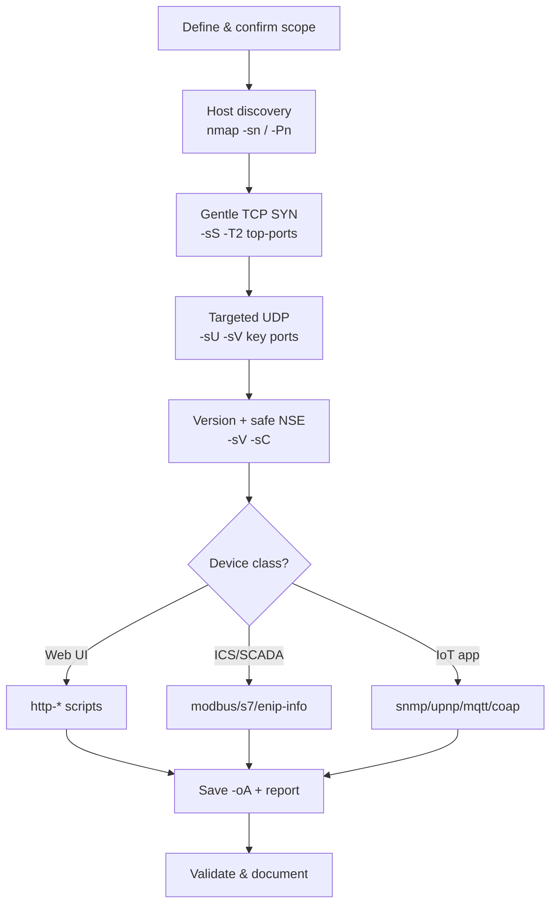

# 🛰️ Nmap for Embedded & IoT Devices — Advanced Cheatsheet


> A field reference for scanning fragile, resource-constrained targets — routers, cameras,
> PLCs, printers, smart-home hubs, medical and industrial gear — where an aggressive scan
> can **crash the device**, not just trip an alert.

---

> [!CAUTION]
> **Only scan systems you own or are explicitly authorized to test.** Unauthorized scanning
> is illegal in most jurisdictions. Embedded TCP/IP stacks are often minimal and brittle:
> SYN floods, UDP probes, and OS fingerprinting have been documented to **reboot or hang**
> real devices (PLCs, IP cameras, VoIP phones, medical equipment). Treat every embedded
> target as production until proven otherwise.

---

## 📑 Table of Contents

1. [Why embedded targets are different](#-why-embedded-targets-are-different)
2. [Quick reference card](#-quick-reference-card)
3. [Host discovery](#-host-discovery)
4. [TCP scanning](#-tcp-scanning)
5. [UDP scanning](#-udp-scanning-the-important-one)
6. [SCTP & other protocols](#-sctp--protocol-scan)
7. [Service & version detection](#-service--version-detection)
8. [OS detection & fingerprinting](#-os-detection--fingerprinting)
9. [Timing & performance (gentle mode)](#-timing--performance--gentle-mode)
   - [Fast scanning (two-stage method)](#-fast-scanning--two-stage-method)
10. [NSE: the scripting engine](#-nse--the-scripting-engine)
11. [Industrial / ICS / SCADA protocols](#-industrial--ics--scada-protocols)
12. [IoT application protocols](#-iot-application-protocols)
13. [Web interface scanning](#-web-interface-scanning)
14. [Firewall / IDS evasion](#-firewall--ids-evasion)
15. [Output & reporting](#-output--reporting)
16. [Full recon workflows](#-full-recon-workflows)
17. [Survival rules for fragile devices](#-survival-rules-for-fragile-devices)

---

## 🔍 Why embedded targets are different

| Factor | Desktop/Server | Embedded/IoT |
|---|---|---|
| TCP/IP stack | Robust (Linux/Windows) | Minimal (lwIP, uIP, vendor RTOS) — easily overwhelmed |
| Open ports | Many, well-behaved | Few, often non-standard, sometimes undocumented |
| UDP services | Secondary | **Primary** (SNMP, TFTP, CoAP, mDNS, SSDP) — scan UDP seriously |
| Response to load | Degrades gracefully | May **reset, hang, or corrupt state** |
| Timing tolerance | High | Low — slow down or you get false "closed/filtered" |
| OS detection | Accurate | Often misidentified; still useful for stack fingerprint |

> [!TIP]
> On embedded gear, **UDP + version detection + targeted NSE** usually tells you more than
> a loud full-range TCP sweep. Start quiet, widen deliberately.

---

## ⚡ Quick reference card

<details>
<summary><b>Click to expand the one-screen cheat table</b></summary>

| Goal | Command |
|---|---|
| Fast TCP top-ports | `nmap -sS --top-ports 100 -T2 <tgt>` |
| Full TCP, gentle | `nmap -sS -p- -T2 --max-retries 2 <tgt>` |
| Common UDP | `nmap -sU --top-ports 50 -T2 <tgt>` |
| Version + light scripts | `nmap -sV -sC -T2 <tgt>` |
| OS fingerprint | `nmap -O --osscan-limit <tgt>` |
| No-ping (device drops ICMP) | `nmap -Pn <tgt>` |
| Single host, full profile | `nmap -sS -sU -sV -O -p- --top-ports-udp 100 -T2 <tgt>` |
| Subnet discovery only | `nmap -sn 192.168.1.0/24` |
| SCADA/ICS safe probe | `nmap --script modbus-discover,s7-info -p 502,102 <tgt>` |
| Web enum | `nmap -sV --script "http-* and not dos" -p 80,443,8080,8443 <tgt>` |
| Save everything | `nmap -oA scan_name <tgt>` |

</details>

---

## 🎯 Host discovery

Embedded devices frequently block ICMP or sit behind NAT, so discovery needs variety.

```bash
# Ping sweep (ARP on local LAN — fast & reliable for embedded)
nmap -sn 192.168.1.0/24

# Skip host discovery entirely (device drops pings but is up)
nmap -Pn <target>

# Mixed discovery probes (TCP SYN/ACK + ICMP + UDP) — good for stubborn devices
nmap -sn -PS22,80,443 -PA80 -PU161 -PE -PP 192.168.1.0/24

# ARP-only sweep on the local segment (most accurate for L2-reachable gear)
nmap -sn -PR 192.168.1.0/24

# List targets without sending packets (sanity check your scope)
nmap -sL 192.168.1.0/24
```

| Flag | Probe type | Why it helps on embedded |
|---|---|---|
| `-PS<ports>` | TCP SYN | Device answers on service port even if ICMP is off |
| `-PA<ports>` | TCP ACK | Slips past simple stateless filters |
| `-PU<ports>` | UDP (e.g. 161) | Catches SNMP-only IoT nodes |
| `-PR` | ARP | L2, unspoofable, fastest on a LAN |
| `-PE/-PP/-PM` | ICMP echo/timestamp/netmask | Legacy stacks often answer timestamp/netmask |
| `-Pn` | *skip discovery* | Use when you **know** the host is up |

---

## 📡 TCP scanning

<details>
<summary><b>TCP scan types — full table</b></summary>

| Scan | Flag | Needs root | Notes for embedded |
|---|---|:---:|---|
| SYN / half-open | `-sS` | ✅ | **Default choice** — fast, relatively gentle, no full handshake |
| Connect | `-sT` | ❌ | Full handshake; use when unprivileged; heavier on the stack |
| ACK | `-sA` | ✅ | Maps firewall rules (filtered vs unfiltered), not open/closed |
| Window | `-sW` | ✅ | ACK variant that can infer open ports on some stacks |
| FIN | `-sF` | ✅ | Stealth; **unreliable on non-RFC-compliant embedded stacks** |
| NULL | `-sN` | ✅ | No flags set; many IoT stacks mishandle → false results |
| Xmas | `-sX` | ✅ | FIN+PSH+URG; same caveat as NULL/FIN |
| Maimon | `-sM` | ✅ | FIN/ACK; niche BSD-derived stacks |
| Idle/zombie | `-sI <zombie>` | ✅ | Ultra-stealth, source-spoofed; advanced/situational |

</details>

```bash
# Default SYN scan, top 100 ports, gentle timing
nmap -sS --top-ports 100 -T2 <target>

# Full 65535-port TCP sweep with conservative retries (embedded-safe)
nmap -sS -p- -T2 --max-retries 2 --host-timeout 30m <target>

# Specific port list (don't blast the whole range if you don't need to)
nmap -sS -p 21,22,23,80,443,554,1883,8080,8443,9000 <target>

# Unprivileged environment (no raw sockets) → connect scan
nmap -sT -p- <target>

# Firewall rule mapping (open|filtered discrimination)
nmap -sA -p- <target>
```

> [!WARNING]
> `-sN`, `-sF`, `-sX` rely on RFC 793 behavior. Many embedded stacks (and most Windows-based
> HMIs) do **not** comply, so these produce **misleading** "open|filtered" results. Prefer
> `-sS`/`-sT` on IoT unless you specifically need stealth and can validate results.

---

## 📻 UDP scanning (the important one)

UDP is where embedded devices *live* — SNMP, TFTP, SSDP/UPnP, mDNS, NTP, CoAP, DNS, SIP.
UDP scanning is slow and lossy; **scope it tightly and slow it down.**

```bash
# Common IoT UDP services only (fast, targeted)
nmap -sU -p 53,67,69,123,161,500,1900,5353,5683 <target>

# Top 50 UDP ports, gentle
nmap -sU --top-ports 50 -T2 <target>

# UDP + version detection (sends protocol payloads → far more accurate)
nmap -sU -sV -p 161,1900,5353,5683 <target>

# Combined TCP+UDP in one pass
nmap -sS -sU -p T:22,80,443,U:161,1900,5353 <target>
```

| Key UDP port | Service | Embedded relevance |
|---|---|---|
| 69 | TFTP | Firmware upload/download on routers, phones, PLCs |
| 123 | NTP | Time sync; `ntp-monlist` can leak host info |
| 161/162 | SNMP | **Huge** — config/version/interface disclosure |
| 1900 | SSDP/UPnP | Device discovery & description XML |
| 5353 | mDNS | Bonjour/Avahi device & service names |
| 5683 | CoAP | Constrained IoT REST protocol |
| 47808 | BACnet | Building automation |

> [!NOTE]
> Plain `-sU` without `-sV` marks most UDP ports `open|filtered` because closed ports reply
> with ICMP but open ones often stay silent. **Add `-sV`** so Nmap sends real protocol
> payloads and gets definitive answers.

---

## 🔗 SCTP & protocol scan

```bash
# SCTP INIT scan (telecom / some industrial gateways)
nmap -sY -p 80,2905,9999 <target>

# SCTP COOKIE-ECHO (stealthier SCTP variant)
nmap -sZ <target>

# IP protocol scan — which L3 protocols the host speaks (ICMP, IGMP, GRE, etc.)
nmap -sO <target>
```

---

## 🧬 Service & version detection

```bash
# Standard version detection
nmap -sV <target>

# Crank intensity (0 = light/fast, 9 = all probes/thorough) — lower on fragile gear
nmap -sV --version-intensity 2 <target>

# Light & fast (fewer probes — kinder to embedded stacks)
nmap -sV --version-light <target>

# Maximum (noisy — only on robust targets)
nmap -sV --version-all <target>

# Capture banners without heavy probing
nmap -sV --script banner <target>
```

| Option | Effect |
|---|---|
| `--version-intensity 0-9` | Probe aggressiveness (default 7) |
| `--version-light` | Alias for intensity 2 |
| `--version-all` | Alias for intensity 9 |
| `--version-trace` | Debug which probes matched |

---

## 🖥️ OS detection & fingerprinting

```bash
# OS detection
nmap -O <target>

# Only fingerprint promising hosts (needs 1 open + 1 closed TCP port)
nmap -O --osscan-limit <target>

# Guess aggressively when signatures are imperfect (common for embedded)
nmap -O --osscan-guess <target>

# Everything in one line: OS + version + default scripts + traceroute
nmap -A <target>
```

> [!TIP]
> Embedded OS detection is frequently *wrong* (shows "Linux 2.6.x" for any BusyBox box, or
> a generic VxWorks/embedded guess). The **device/vendor line** and **TCP stack fingerprint**
> are still valuable even when the exact version guess is off. Combine with `-sV` banners and
> NSE for identity.

---

## ⏱️ Timing & performance — *gentle mode*

This section matters **more for embedded than anything else.** Too fast = crashes and false
negatives.

| Template | Name | Use on embedded? |
|---|---|---|
| `-T0` | Paranoid | IDS-evasion, serial-link-slow; rarely needed |
| `-T1` | Sneaky | Very fragile / monitored targets |
| `-T2` | Polite | ✅ **Recommended default for IoT/ICS** |
| `-T3` | Normal | Default; OK on robust embedded Linux |
| `-T4` | Aggressive | ⚠️ Risky on constrained devices |
| `-T5` | Insane | ❌ Will likely break fragile stacks |

```bash
# Fine-grained throttling (safer than a raw template)
nmap -sS -p- \
  --min-rate 50 --max-rate 300 \     # packets/sec ceiling
  --max-retries 2 \                  # don't hammer non-responders
  --scan-delay 50ms \                # pause between probes
  --max-parallelism 10 \             # cap concurrent probes
  --host-timeout 20m \               # give up on dead hosts
  <target>
```

> [!WARNING]
> On ICS/SCADA and medical devices, prefer `-T2` or explicit `--scan-delay` + `--max-rate`.
> A single PLC rebooting mid-process is a real-world safety incident, not a lab inconvenience.

### ⚡ Fast scanning — two-stage method

The single biggest speed win isn't a faster template — it's **not running version/script
detection against 65535 ports.** Sweep for open ports first, then deep-scan only those.

```bash
# Stage 1 — raw-speed port discovery (no -sV, no scripts)
sudo nmap -sS -p- -T4 --min-rate 1000 -n -Pn --open -oG ports.txt <target>

# Stage 2 — heavy scan on ONLY the open ports
ports=$(grep -oP '\d+/open' ports.txt | cut -d/ -f1 | paste -sd,)
sudo nmap -sV -sC -O -T4 -n -Pn -p "$ports" <target>
```

**All-in-one aggressive** (`-A` = `-O -sV -sC --traceroute`; scans top 1000 ports only):

```bash
sudo nmap -A -T4 -Pn -n --open <target>
```

**Shortest useful fast scan** (top 100 ports, with versions):

```bash
sudo nmap -sV -T4 -F -n -Pn --open <target>
```

| Speed flag | Effect |
|---|---|
| `-T4` | Aggressive timing template |
| `--min-rate 1000` | Force ≥1000 pkt/s (overrides template when net allows) |
| `-n` | Skip reverse-DNS — saves time on every host |
| `-F` | Fast mode: top 100 ports instead of 1000 |
| `--top-ports N` | Scan the N most common ports only |
| `--open` | Process/report open ports only |
| `-A` | Bundle OS + version + default scripts + traceroute |

> [!WARNING]
> `-T4 --min-rate 1000` is for robust embedded Linux, **not** fragile IoT or ICS. On a brittle
> stack it causes false `filtered` results or hangs. Drop to `-T3`/`-T2` and `--min-rate 300`
> if results look wrong or the device gets flaky. Never exceed `-T2` on a PLC.

---

## 🧩 NSE — the scripting engine

NSE is where Nmap becomes a vulnerability/enumeration platform. Scripts live in
`/usr/share/nmap/scripts/`.

<details>
<summary><b>Script categories</b></summary>

| Category | What it does | Embedded caution |
|---|---|---|
| `safe` | Non-intrusive | ✅ Preferred |
| `default` (`-sC`) | Common, reasonably safe | ✅ Good baseline |
| `discovery` | Enumerate services/hosts | ✅ Usually fine |
| `version` | Aid version detection | ✅ |
| `auth` | Authentication checks | ⚠️ May lock accounts |
| `brute` | Credential brute force | ❌ Can lock out / crash |
| `vuln` | Known-vuln checks | ⚠️ Some are intrusive |
| `exploit` | Actively exploit | ❌ Destructive |
| `dos` | Denial of service | ❌ **Never on production** |
| `intrusive` | Heavy/risky | ⚠️ Review before running |

</details>

```bash
# Default safe scripts
nmap -sC <target>

# A single script
nmap --script snmp-info -p 161 -sU <target>

# Multiple / wildcards
nmap --script "snmp-*" -sU -p 161 <target>

# Boolean selection: web scripts but nothing dangerous
nmap --script "http-* and not (brute or dos)" -p 80,443 <target>

# Only safe + default categories
nmap --script "safe,default" <target>

# Pass arguments to a script
nmap --script http-title --script-args http.useragent="Mozilla/5.0" -p 80 <target>

# Update the script database after adding scripts
nmap --script-updatedb
```

> [!TIP]
> Vet unknown scripts first: `nmap --script-help "<name>"` prints purpose, categories, and
> args **without running anything.**

---

## 🏭 Industrial / ICS / SCADA protocols

> [!CAUTION]
> ICS gear is the most fragile class of target. Use **read-only discovery scripts only**,
> `-T2` or slower, and ideally test in a lab/maintenance window first.

```bash
# Modbus TCP (PLCs, RTUs)
nmap --script modbus-discover -p 502 <target>

# Siemens S7 (S7-300/400/1200/1500)
nmap --script s7-info -p 102 <target>

# EtherNet/IP (Allen-Bradley / Rockwell)
nmap --script enip-info -sU -p 44818 <target>

# BACnet (building automation / HVAC)
nmap --script bacnet-info -sU -p 47808 <target>

# DNP3 (power/utility SCADA)
nmap --script dnp3-info -p 20000 <target>

# Niagara Fox (Tridium building controllers)
nmap --script fox-info -p 1911,4911 <target>

# OMRON FINS / general PLC sweep
nmap --script omron-info -sU -p 9600 <target>
```

| Protocol | Port | Script |
|---|---|---|
| Modbus | 502/tcp | `modbus-discover` |
| Siemens S7 | 102/tcp | `s7-info` |
| EtherNet/IP | 44818/udp | `enip-info` |
| BACnet | 47808/udp | `bacnet-info` |
| DNP3 | 20000/tcp | `dnp3-info` |
| Niagara Fox | 1911/tcp | `fox-info` |
| PCWorx | 1962/tcp | `pcworx-info` |
| ProConOS | 20547/tcp | `proconos-info` |

---

## 📶 IoT application protocols

```bash
# UPnP / SSDP — pull device description & service list
nmap -sU -p 1900 --script upnp-info <target>

# mDNS / Bonjour service enumeration
nmap -sU -p 5353 --script dns-service-discovery <target>

# SNMP deep enumeration (interfaces, processes, software, netstat)
nmap -sU -p 161 --script "snmp-info,snmp-interfaces,snmp-netstat,snmp-processes,snmp-sysdescr" <target>

# MQTT broker (smart home / telemetry) — subscribe & dump topics
nmap -p 1883 --script mqtt-subscribe <target>

# CoAP resource discovery (constrained devices)
nmap -sU -p 5683 --script coap-resources <target>

# RTSP (IP cameras) — enumerate stream URLs
nmap -p 554 --script rtsp-url-brute,rtsp-methods <target>

# Telnet (still everywhere on cheap IoT)
nmap -p 23 --script telnet-ntlm-info,telnet-encryption <target>
```

| Protocol | Port | Device type | Script |
|---|---|---|---|
| UPnP/SSDP | 1900/udp | Routers, media, smart home | `upnp-info` |
| mDNS | 5353/udp | Printers, cast devices | `dns-service-discovery` |
| SNMP | 161/udp | Almost everything | `snmp-*` |
| MQTT | 1883/tcp | Sensors, hubs | `mqtt-subscribe` |
| CoAP | 5683/udp | Low-power sensors | `coap-resources` |
| RTSP | 554/tcp | IP cameras | `rtsp-url-brute` |
| Telnet | 23/tcp | Legacy IoT | `telnet-encryption` |

---

## 🌐 Web interface scanning

Most embedded devices expose a management web UI — often the softest attack surface.

```bash
# Baseline web enumeration (safe subset)
nmap -sV --script "http-* and not (brute or dos or fuzz)" \
  -p 80,443,8080,8443,8000,8888 <target>

# Core recon scripts
nmap -p 80,443 --script \
  http-title,http-headers,http-methods,http-server-header,http-auth,http-robots.txt \
  <target>

# Directory / interesting-path discovery
nmap -p 80 --script http-enum <target>

# Default-credential check on known device panels (use responsibly)
nmap -p 80 --script http-default-accounts <target>

# TLS posture on HTTPS management interfaces
nmap -p 443 --script ssl-cert,ssl-enum-ciphers,tls-alpn <target>

# Pull favicon hash / fingerprint the appliance
nmap -p 80,443 --script http-favicon <target>
```

| Script | Reveals |
|---|---|
| `http-title` | Device model often in page title |
| `http-headers` | `Server:` banner, auth realm |
| `http-auth` | Auth scheme & realm (vendor hint) |
| `http-default-accounts` | Known default logins |
| `http-enum` | Admin paths, firmware pages |
| `ssl-cert` | CN/SAN can leak hostname & vendor |
| `ssl-enum-ciphers` | Weak/legacy TLS on the mgmt UI |

---

## 🛡️ Firewall / IDS evasion

<details>
<summary><b>Evasion techniques (use only when authorized & necessary)</b></summary>

```bash
# Fragment packets (split headers across tiny IP fragments)
nmap -f <target>
nmap -ff <target>              # even smaller fragments

# Custom MTU (must be a multiple of 8)
nmap --mtu 16 <target>

# Decoys — hide your real IP in a crowd
nmap -D RND:5 <target>                      # 5 random decoys
nmap -D 10.0.0.1,10.0.0.2,ME,10.0.0.3 <target>

# Spoof source port (bypass weak port-based ACLs; 53/67/88 often allowed)
nmap --source-port 53 <target>

# Idle/zombie scan — zero packets from your real IP
nmap -sI <zombie_host> <target>

# Append random data to confuse signature matching
nmap --data-length 50 <target>

# Randomize host scan order
nmap --randomize-hosts -iL targets.txt

# Spoof MAC (vendor prefix or random)
nmap --spoof-mac Cisco <target>
nmap --spoof-mac 0 <target>                  # fully random
```

</details>

> [!WARNING]
> Fragmentation (`-f`, `--mtu`) and malformed-packet evasion can themselves **crash minimal
> embedded reassembly stacks.** Evasion and fragility are in direct tension — prefer clean
> probes on IoT and reserve evasion for hardened, monitored targets.

---

## 💾 Output & reporting

```bash
# All three major formats at once (normal + XML + grepable) with a base name
nmap -sS -sV -oA engagement_target <target>

# Individual formats
nmap -oN scan.txt <target>      # human-readable
nmap -oX scan.xml <target>      # XML (feed into tools / reporting)
nmap -oG scan.grep <target>     # grepable (quick awk/grep pipelines)

# Verbose + show reason for each port state
nmap -v -vv --reason <target>

# Resume an interrupted scan from its normal/grepable output
nmap --resume engagement_target.nmap

# Append to a running log instead of overwriting
nmap --append-output -oN running_log.txt <target>
```

| Format | Flag | Best for |
|---|---|---|
| Normal | `-oN` | Reading / notes |
| XML | `-oX` | Parsing, dashboards, `xsltproc` HTML reports |
| Grepable | `-oG` | `grep`/`awk` one-liners |
| All | `-oA` | Just use this by default |

```bash
# Turn XML into a styled HTML report
xsltproc engagement_target.xml -o engagement_target.html
```

---

## 🧭 Full recon workflows

### Workflow diagram



### Phased command set

<details open>
<summary><b>Phase 1 — Discover</b></summary>

```bash
nmap -sn -PR 192.168.1.0/24 -oA 01_discovery
```
</details>

<details>
<summary><b>Phase 2 — Gentle TCP footprint</b></summary>

```bash
nmap -sS --top-ports 200 -T2 --max-retries 2 -Pn -iL live_hosts.txt -oA 02_tcp
```
</details>

<details>
<summary><b>Phase 3 — Targeted UDP</b></summary>

```bash
nmap -sU -sV -p 53,69,123,161,500,1900,5353,5683,47808 -T2 -iL live_hosts.txt -oA 03_udp
```
</details>

<details>
<summary><b>Phase 4 — Identify</b></summary>

```bash
nmap -sS -sV -O --osscan-guess -sC -T2 -Pn -iL live_hosts.txt -oA 04_identify
```
</details>

<details>
<summary><b>Phase 5 — Device-class deep dive (pick per target)</b></summary>

```bash
# Web management interface
nmap -sV --script "http-* and not (brute or dos)" -p 80,443,8080,8443 <tgt> -oA 05a_web

# Industrial controller
nmap --script modbus-discover,s7-info,enip-info -p 502,102 -sU -p 44818 <tgt> -oA 05b_ics

# Generic IoT node
nmap -sU --script "snmp-*,upnp-info,coap-resources" -p 161,1900,5683 <tgt> -oA 05c_iot
```
</details>

### One-liner "full but gentle" single-host profile

```bash
nmap -sS -sU -sV -O --osscan-guess -sC \
  -p T:1-65535,U:53,69,123,161,500,1900,5353,5683,47808 \
  -T2 --max-retries 2 --host-timeout 45m -Pn \
  --reason -v -oA full_profile <target>
```

---

## ✅ Survival rules for fragile devices

- [ ] **Confirm written authorization** before any packet leaves your interface.
- [ ] Start with `-T2` (or slower) and `--max-retries 2` on anything embedded.
- [ ] Prefer `-sS`/`-sT` over `-sN`/`-sF`/`-sX` on non-RFC-compliant stacks.
- [ ] Always pair `-sU` with `-sV` so UDP results are meaningful.
- [ ] Use **safe/default** NSE categories; read `--script-help` before anything `intrusive`.
- [ ] Never run `dos`, `exploit`, or `brute` scripts on production or ICS.
- [ ] Scope ports deliberately — don't `-p-` a PLC just because you can.
- [ ] Monitor the device during the scan (ping/console) and **stop if it misbehaves**.
- [ ] Save with `-oA` from the start so nothing is lost.
- [ ] Re-scan to validate findings before reporting — embedded stacks give flaky results.

---

> [!NOTE]
> **Reference files on a standard install:** scripts in `/usr/share/nmap/scripts/`,
> service/port data in `/usr/share/nmap/nmap-services`, version probes in
> `nmap-service-probes`, OS fingerprints in `nmap-os-db`. Keep Nmap current
> (`nmap --version`) — NSE and fingerprint databases improve meaningfully between releases.

*Reference material for authorized security assessment and network administration only.*
